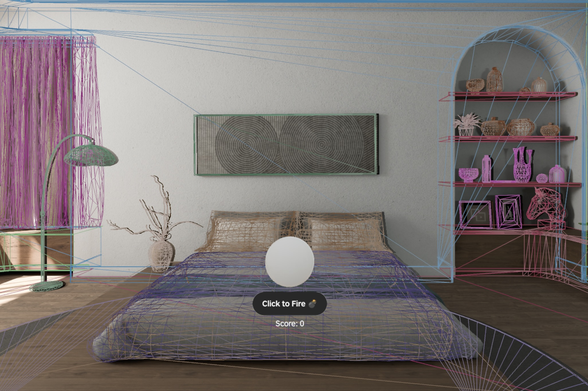
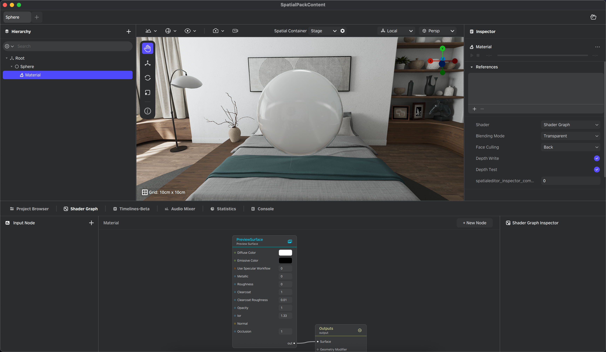

# Spatial Mesh

[English](README.md) | [简体中文](README_zh.md)

A reference application for PICO OS 6 demonstrating spatial mesh capabilities with the PICO Spatial SDK. Spatial Mesh scans the real-world environment surface mesh in real time, renders it as a semi-transparent wireframe, and lets users shoot physics projectiles (aimed by the HMD pose) at the scanned surfaces.

## Overview

Spatial Mesh is a complete reference sample for building interactions on top of a live spatial mesh. It demonstrates the full workflow: start/stop mesh tracking, render scanned meshes, and use the same mesh data for physics collisions in gameplay.

What you'll learn:

- Manage the mesh tracking lifecycle and incremental updates (added/updated/removed anchors)
- Render scanned meshes with collision that matches what you see (static mesh collision shape)
- Implement HMD-aimed shooting with pooled projectiles to reduce GC spikes
- Drive gameplay feedback from collision events (score + spatial audio)



## Features

Spatial Mesh Sample highlights the following core capabilities of the PICO Spatial SDK:

- **Spatial Mesh Scanning**: real-time environmental mesh scanning using PICO's spatial sensing technology
- **Mesh Visualization**: dynamic mesh rendering with wireframe visualization and random color assignment
- **Interactive Shooting Gameplay**: HMD tracking-based aiming and shooting mechanics
- **Physics-based Projectiles**: realistic projectile physics with collision detection and response
- **Audio Feedback System**: spatial audio effects for shooting and impact events with audio pooling
- **ECS Architecture**: component-based entity management for clean separation of concerns
- **Efficient Resource Management**: asset bundle loading and audio resource pooling for optimal performance

## Requirements

To build and run this project, configure your development environment by following the official PICO Spatial SDK setup guide:

- [PICO Spatial SDK Setup Guide (Outside Chinese Mainland)](https://developer.picoxr.com/document/spatial-sdk/set-up-development-environment/)
- [PICO Spatial SDK Setup Guide (Chinese Mainland)](https://developer-cn.picoxr.com/document/spatial-sdk/set-up-development-environment/)

## Getting Started

### 1. Clone the Repository

```bash
git clone <repository-url>
cd SpatialMesh
```

### 2. Open in Android Studio

Launch Android Studio, select **Open an Existing Project**, and choose the `SpatialMesh` directory.

### 3. Run the App

#### On Emulator

1. Open **Device Manager** (toolbar or **Tools > Device Manager**)
2. Click **Add a new device** > **Create a PICO Emulator**
3. Start the emulator from **Device Manager**
4. Click **Run 'app'** to launch the app

#### On Physical Device

1. Connect your PICO device to your development machine
2. Enable **USB Debugging** on the device
3. Click **Run 'app'** to deploy directly to your device

## Project Structure

Spatial Mesh Sample follows a modular ECS architecture to separate application logic from 3D resources:

```txt
SpatialMesh/
├── app/                                  # Main application module
│   └── src/main/
│       ├── java/com/pico/spatial/sample/spatialmesh/ # Kotlin source files
│       │   ├── Main.kt                     # Entry point: sets up the spatial UI container and starts the main scene
│       │   ├── data/                       # Data layer: asset bundle loading, audio definitions, and global config
│       │   │   ├── AssetBundle.kt          # Loads the Spatial Editor bundle and provides async access
│       │   │   ├── Audio.kt                # Registers audio IDs and sound definitions
│       │   │   └── GlobalConfig.kt         # Centralized tuning parameters (e.g., emulator flags)
│       │   ├── ecs/                        # Entity Component System architecture
│       │   │   ├── components/             # ECS components (Ammo, Shooter, SpatialMesh)
│       │   │   ├── entities/               # ECS entity definitions
│       │   │   └── systems/                # ECS systems (Ammo, Shooter)
│       │   ├── manager/                    # High-level controllers and SDK bridges
│       │   │   ├── AmmoManager.kt          # Projectile pool to reduce GC pressure
│       │   │   ├── GameplayManager.kt      # Hit rules, scoring bridge, and game state reset
│       │   │   └── MeshScanManager.kt      # Subscribes to mesh anchors and builds mesh entities
│       │   ├── platform/                   # Platform-specific implementations
│       │   │   ├── LaunchActivity.kt       # Android launcher activity
│       │   │   └── SpatialApplication.kt   # App initialization
│       │   ├── ui/                         # Compose UI and stage lifecycle
│       │   │   ├── GameScene.kt            # Main stage: init/cleanup, input routing, and collision subscription
│       │   │   ├── GameUIBridge.kt         # Bridge from ECS to UI state (score updates)
│       │   │   └── GameViewModel.kt        # UI state holder (score + tutorial tip)
│       │   └── util/                       # Helper utilities
│       ├── assets/                         # Audio assets (background music, sound effects)
│       ├── res/                            # Android resources
│       └── AndroidManifest.xml             # App manifest with Spatial component declarations
├── editor-asset/                         # 3D resources and Spatial Editor project
│   └── src/main/res3d/SpatialPackContent/ # Spatial Editor project with 3D assets
├── gradle/                               # Gradle dependencies and scripts
├── build.gradle.kts                      # Root build configuration
└── settings.gradle.kts                   # Project settings and SDK configuration
```

### Where to Start

- `ui/GameScene.kt` — best entry point to understand how the sample is wired end-to-end
- `manager/MeshScanManager.kt` — shows how the Spatial SDK mesh stream is turned into renderable and collidable entities
- `manager/AmmoManager.kt` — demonstrates a simple entity pool pattern for high-frequency objects

## Editing 3D Assets

To modify or extend the 3D assets in Spatial Mesh Sample:

1. In Android Studio, expand the **editor-asset** module
2. Navigate to **res3d/SpatialPackContent/ModelView**
3. Click **Open in Editor** in the top-right corner to launch the PICO Spatial Editor
4. Use the editor to adjust the material or other configurations of the Sphere (ammo), or modify existing assets like the Grid or CollisionEffect



## Customization Guide

### Modifying Shooting Mechanics

1. Edit `GlobalConfig.kt` to adjust projectile speed, spawn rate, or despawn timer
2. Modify `ShooterSystem.kt` to change the firing logic or ammo spawning behavior
3. Update `AmmoComponent.kt` to add new properties to projectiles

### Adjusting Mesh Visualization

1. Modify `MeshScanManager.kt` to change mesh material properties (opacity, polygon fill mode, colors)
2. Adjust collision filter settings to change what objects interact with the spatial mesh

### Adding New Audio Effects

1. Place audio files in `app/src/main/assets/audio/`
2. Update `Audio.kt` to register the new audio resources
3. Modify `AudioRepository.kt` to load and manage the new audio files

## Learning Resources

To deepen your understanding of spatial app development, explore the resources on our official developer websites:

- [PICO Developer Website (Outside Chinese Mainland)](https://developer.picoxr.com/)
- [PICO Developer Website (Chinese Mainland)](https://developer-cn.picoxr.com/)

## License

© 2026 PICO. The project's source code is licensed under the [Apache 2.0 License](LICENSE.txt). All assets, including textures, 3D models, audio, and others, are licensed via [Creative Commons BY 4.0](https://creativecommons.org/licenses/by/4.0/).

## Support

For questions, issues, or feature requests, please contact us through the [PICO Developer Support Portal](https://picodevsupport.freshdesk.com/support/home) and submit a ticket.

---

Developed as a reference for spatial application developers
