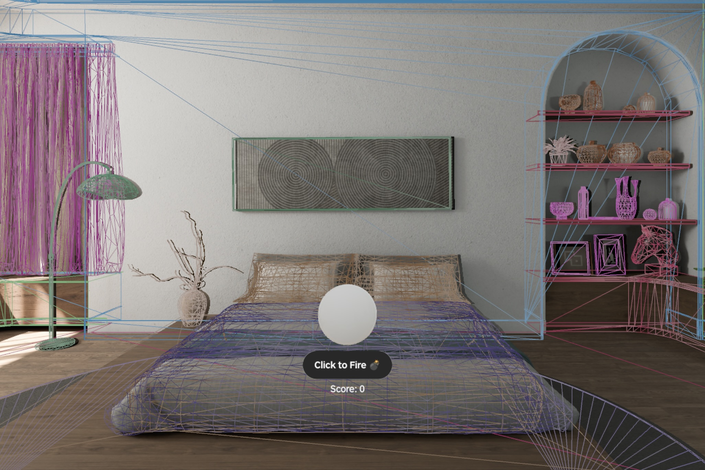
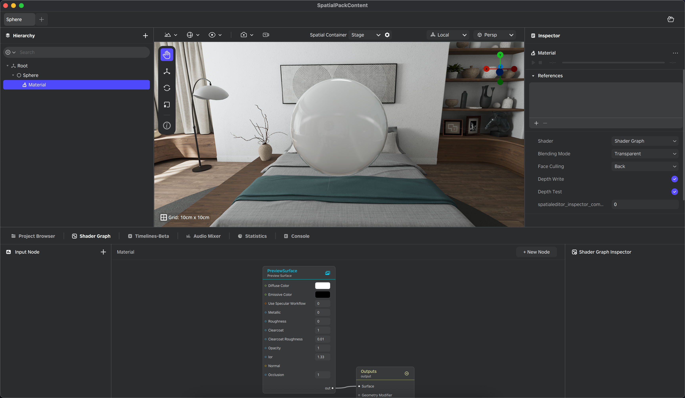

# Spatial Mesh

[English](README.md) | [简体中文](README_zh.md)

Spatial Mesh 是一款基于 PICO OS 6 的参考示例应用，使用 PICO Spatial SDK 演示空间网格能力。Spatial Mesh 实时扫描真实环境的表面网格，以半透明线框的形式渲染，并支持用户通过 HMD 姿态瞄准，向扫描到的表面射击物理弹丸。

## 概览

Spatial Mesh 是一个完整的参考示例，展示了如何基于实时空间网格构建交互体验，涵盖完整工作流：启动/停止网格追踪、渲染扫描网格，以及将同一网格数据用于游戏中的物理碰撞。

本示例涵盖以下学习要点：

- 管理网格追踪生命周期及增量更新（锚点的添加、更新与移除）
- 渲染与视觉一致的碰撞网格（静态网格碰撞形状）
- 实现基于 HMD 瞄准的射击机制，并通过弹丸对象池降低 GC 压力
- 基于碰撞事件驱动游戏反馈（得分与空间音效）



## 功能特性

Spatial Mesh 示例展示了 PICO Spatial SDK 的以下核心能力：

- **空间网格扫描**：使用 PICO 空间感知技术进行实时环境网格扫描
- **网格可视化**：动态网格渲染，支持线框可视化与随机颜色分配
- **交互式射击玩法**：基于 HMD 追踪的瞄准与射击机制
- **物理弹丸**：具备碰撞检测与响应的真实弹丸物理效果
- **音效反馈系统**：支持音频对象池的射击与撞击空间音效
- **ECS 架构**：基于组件的实体管理，实现清晰的关注点分离
- **高效资源管理**：资源包加载与音频资源池，优化运行时性能

## 环境要求

构建和运行本项目前，请参照 PICO Spatial SDK 官方文档完成开发环境配置：

- [PICO Spatial SDK 环境配置指南（中国大陆）](https://developer-cn.picoxr.com/document/spatial-sdk/set-up-development-environment/)
- [PICO Spatial SDK 环境配置指南（非中国大陆）](https://developer.picoxr.com/document/spatial-sdk/set-up-development-environment/)

## 快速开始

### 1. 克隆项目

```bash
git clone <repository-url>
cd SpatialMesh
```

### 2. 在 Android Studio 中打开项目

启动 Android Studio，选择 **Open an Existing Project**，然后选择 `SpatialMesh` 目录。

### 3. 运行项目

#### 在模拟器上运行

1. 打开 **Device Manager**（可通过工具栏或 **Tools > Device Manager** 进入）
2. 点击 **Add a new device** > **Create a PICO Emulator**
3. 在 **Device Manager** 中启动模拟器
4. 点击 **Run 'app'** 启动应用

#### 在物理设备上运行

1. 将 PICO 设备连接至开发机
2. 在设备上启用 **USB 调试（USB Debugging）**
3. 点击 **Run 'app'** 将应用直接部署到设备

## 项目结构

Spatial Mesh 示例采用模块化 ECS 架构，将应用逻辑与 3D 资源分离：

```txt
SpatialMesh/
├── app/                                  # 主应用模块
│   └── src/main/
│       ├── java/com/pico/spatial/sample/spatialmesh/ # Kotlin 源代码
│       │   ├── Main.kt                     # 应用入口：初始化空间 UI 容器并启动主场景
│       │   ├── data/                       # 数据层：资源包加载、音频定义与全局配置
│       │   │   ├── AssetBundle.kt          # 加载 Spatial Editor 资源包并提供异步访问
│       │   │   ├── Audio.kt                # 注册音频 ID 与音效定义
│       │   │   └── GlobalConfig.kt         # 集中管理调节参数（如模拟器标志）
│       │   ├── ecs/                        # 实体组件系统架构
│       │   │   ├── components/             # ECS 组件（Ammo、Shooter、SpatialMesh）
│       │   │   ├── entities/               # ECS 实体定义
│       │   │   └── systems/                # ECS 系统（Ammo、Shooter）
│       │   ├── manager/                    # 高级控制器与 SDK 桥接
│       │   │   ├── AmmoManager.kt          # 弹丸对象池，降低 GC 压力
│       │   │   ├── GameplayManager.kt      # 命中规则、得分桥接与游戏状态重置
│       │   │   └── MeshScanManager.kt      # 订阅网格锚点并构建网格实体
│       │   ├── platform/                   # 平台相关实现
│       │   │   ├── LaunchActivity.kt       # Android 启动 Activity
│       │   │   └── SpatialApplication.kt   # 应用初始化
│       │   ├── ui/                         # Compose UI 与 Stage 生命周期
│       │   │   ├── GameScene.kt            # 主 Stage：初始化/清理、输入路由与碰撞订阅
│       │   │   ├── GameUIBridge.kt         # ECS 到 UI 状态的桥接（得分更新）
│       │   │   └── GameViewModel.kt        # UI 状态持有者（得分与新手提示）
│       │   └── util/                       # 工具类
│       ├── assets/                         # 音频资源（背景音乐、音效）
│       ├── res/                            # Android 资源
│       └── AndroidManifest.xml             # 包含 Spatial 组件声明的应用清单
├── editor-asset/                         # 3D 资源与 Spatial Editor 项目
│   └── src/main/res3d/SpatialPackContent/ # 包含 3D 资源的 Spatial Editor 项目
├── gradle/                               # Gradle 依赖与构建脚本
├── build.gradle.kts                      # 根构建配置
└── settings.gradle.kts                   # 项目设置与 SDK 配置
```

### 推荐入口

- `ui/GameScene.kt` — 了解示例整体架构的最佳起点
- `manager/MeshScanManager.kt` — 演示如何将 Spatial SDK 网格流转换为可渲染与可碰撞的实体
- `manager/AmmoManager.kt` — 演示针对高频对象的简单实体池模式

## 编辑 3D 资源

如需修改或扩展 Spatial Mesh 示例中的 3D 资源，请按以下步骤操作：

1. 在 Android Studio 中展开 **editor-asset** 模块
2. 导航至 **res3d/SpatialPackContent/ModelView**
3. 点击右上角的 **Open in Editor** 启动 PICO Spatial Editor
4. 在编辑器中调整球体（弹丸）的材质或其他配置，或修改 Grid、CollisionEffect 等现有资产



## 自定义指南

### 修改射击机制

1. 编辑 `GlobalConfig.kt`，调整弹丸速度、生成频率或消亡计时器
2. 修改 `ShooterSystem.kt`，更改射击逻辑或弹丸生成行为
3. 更新 `AmmoComponent.kt`，为弹丸添加新属性

### 调整网格可视化

1. 修改 `MeshScanManager.kt`，调整网格材质属性（透明度、多边形填充模式、颜色）
2. 调整碰撞过滤设置，控制哪些对象与空间网格发生交互

### 添加新音效

1. 将音频文件放入 `app/src/main/assets/audio/`
2. 更新 `Audio.kt`，注册新音频资源
3. 修改 `AudioRepository.kt`，加载并管理新音频文件

## 学习资源

深入了解空间应用开发，欢迎访问官方开发者网站获取完整资源：

- [PICO 开发者网站（中国大陆）](https://developer-cn.picoxr.com/)
- [PICO 开发者网站（非中国大陆）](https://developer.picoxr.com/)

## 许可证

© 2026 PICO。本项目的源代码依据 [Apache 2.0 License](LICENSE.txt) 协议开源。本项目的美术资产（包括但不限于纹理、3D 模型和音频）基于 [Creative Commons BY 4.0](https://creativecommons.org/licenses/by/4.0/) 授权。

## 支持

如有任何问题、疑惑或功能建议，欢迎通过 [PICO 开发者支持门户](https://picodevsupport.freshdesk.com/support/home) 提交工单与我们联系。

---

为空间应用开发者提供的官方参考示例
